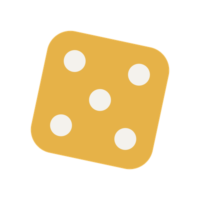
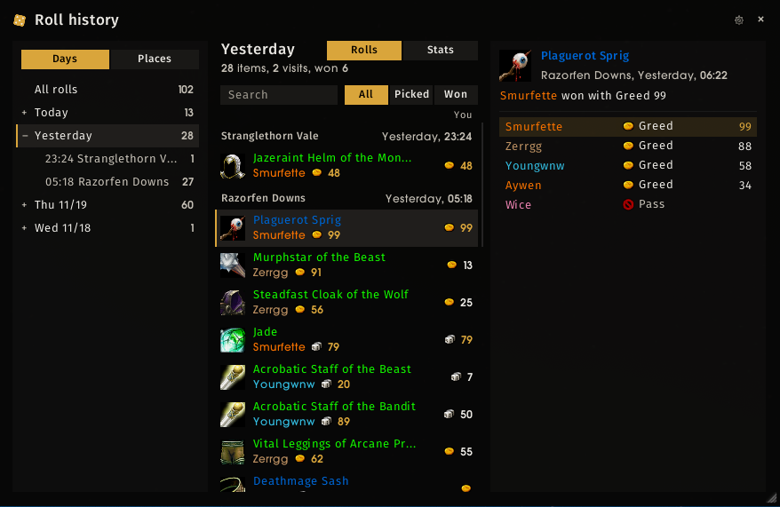
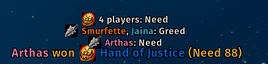
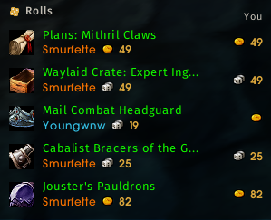
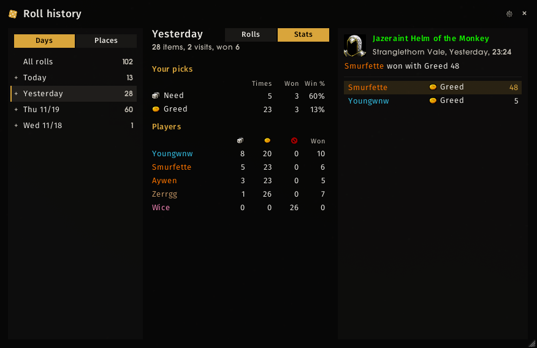

# WhoRolled: Loot Roll Tracker & History

Shows who pressed Need, Greed or Pass on each item in WoW Forever, the moment they press it, and who won with what roll. Every roll is kept in a history by day and by place, with a table of who picked what.

## Floating text

A line pops up in one spot on your screen the moment someone presses a button, with the item icon and the player's name: "Jaina: Need". It has no number yet, because Forever rolls the numbers only when the roll ends.

Players who press the same button on the same item share one line ("Jaina, Sylvanas: Pass"). From 4 players on, the line shows a count instead ("25 players: Pass"), so a raid doesn't flood your screen. When the roll ends, the winner gets a larger gold line: "Arthas won Hand of Justice (Need 87)".

The text shows up for items of Uncommon quality and better (you can raise it to Rare or Epic). Lines stay 3 seconds (1 to 8) at text size 15 (12 to 28). To move the text, open the **Floating text** tab of the settings and drag the box that appears.

## Rolls window

A small window with the latest 5 rolls (1 to 15), newest on top. It grows and shrinks with the number of rolls.

While an item rolls, a gold bar runs down with the roll timer, and the line under the item counts the picks so far with the game's icons, for example "Need 2, Greed 1, 2 waiting". When the roll ends, that line shows the winner in their class color with their pick and roll, or "Everyone passed". The column under **You** shows your own pick and roll.

Click a roll to open it in the roll history. Click the title to open or close the history, drag the title to move the window, right-click for the settings. If you close the window, it comes back with the next roll, unless you set it to show up only on command.

## Roll history

A large window with three columns.

On the left you choose what to look at: **All rolls**, your days (**Days**) or your dungeons, raids and zones (**Places**). Each day or place opens into your visits there, for example "Blackrock Spire, 21:40".

The middle column lists what dropped there, newest first, grouped by visit. Search by player or item, or switch from **All** to **Picked** (items you picked Need or Greed on) or **Won**.

The right column shows the roll you clicked: every player, what they picked and what they rolled, with the winner in gold. Players who let the timer run out are marked "Didn't pick", a winner after a tie is marked "reroll", and in a raid you also get the count for each button. If a higher roll lost because that player already won a copy of the item, it is marked "has a copy". The roll updates live while it is still going.

Click a player's name, or type it in full in the search, to see the rolls they were in. The column on the right then shows their pick and roll instead of yours, and **Picked** and **Won** show theirs. Hover an item for its tooltip, shift-click it to link it in chat. Press Escape to close the window.

## Stats

The **Stats** tab counts whatever you picked on the left: all rolls, one day, one place or one visit.

**Your picks** shows how often you picked Need, Greed or Pass or let the timer run out, how many of those you won and your win rate. **Players** lists everyone who rolled with you, with how many times they picked Need, Greed and Pass and how many items they won, most Need first. Click a name to see their rolls.

History is saved per character, the last 2000 items. It survives `/reload` and logging out. Rolls that finished while you were reloading are picked up from the game when you come back.

## What it can't show

Master loot, free for all and round robin have no rolls, so there is nothing to show. Random rolls with `/roll` are not tracked, because Forever hides system chat messages from addons in dungeons and raids. Rolls from before you logged in are lost, because the game keeps only the current session.

## Settings

`/wroll` opens or closes the roll history, `/wroll window` shows or hides the rolls window, `/wroll options` opens the settings, `/wroll test` plays example rolls.

The **Floating text** tab turns the text on or off and sets what it shows (players' picks, the winner line), the item quality, the text size and the time on screen. **Windows** sets when the rolls window shows up (always, in a group, or only on command), how many rolls it shows, the lock and the background opacity, and clears the history. **General** has the minimap button and the language.

The **Preview** switch at the top of the settings plays example rolls in a loop, so you can tune the text and the windows without a group. Nothing from the preview is saved.
